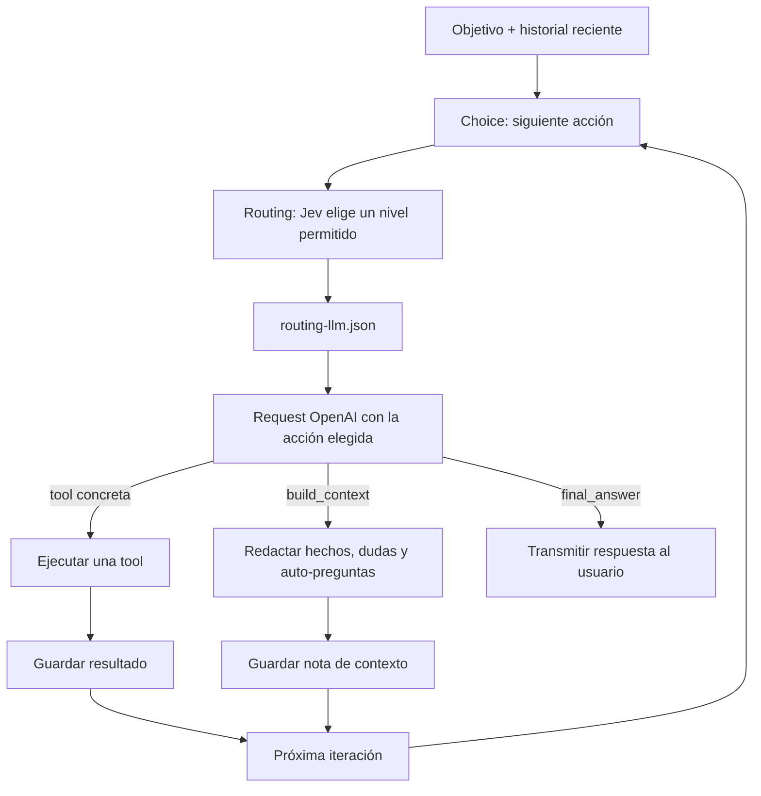

# Jev Decision Model: guía para la clase

El módulo separa las decisiones pequeñas del razonamiento largo del LLM. El objetivo y el historial siguen perteneciendo al agente principal; Jev recibe el estado resumido y devuelve una etiqueta de una lista cerrada.

## 1. Choice decide qué hacer ahora

`decision_model/choices.py` construye un `Choice` con etiquetas como:

- `tool__read_file` o `tool__mcp_<servidor>_<nombre>`: ejecutar una tool disponible.
- `build_context`: pedir al LLM una nota para orientar otra iteración, sin responder aún.
- `final_answer`: cerrar con una respuesta, sin tools.

El estado que recibe Jev contiene el objetivo, el número de iteración, las últimas entradas útiles y los nombres/descripciones de las acciones. La respuesta queda validada contra esas mismas claves. El siguiente prompt explica al LLM cuál fue la elección para que genere una llamada, una nota de contexto o una respuesta final acorde.

Si la tool elegida no requiere argumentos, el harness la ejecuta directamente y evita la request del modelo. Si necesita argumentos, OpenAI solo recibe ese esquema y `tool_choice` queda fijado a su nombre. El ciclo vuelve a consultar Jev despues de guardar el resultado.

## 2. Routing elige el modelo de esa llamada

`decision_model/routing.py` lee la allowlist de `routing-llm.json` y plantea una segunda `Choice` con seis combinaciones permitidas de modelo y esfuerzo. Jev recibe la tarea, la acción, un extracto reciente, el coste estimado y las descripciones de cada opción; devuelve una clave cerrada. El agente traduce esa clave al ID y a `reasoning.effort` configurados, y nunca acepta un modelo o esfuerzo inventado por Jev.

| Nivel | Modelo | `reasoning.effort` | Uso típico |
| --- | --- | --- | --- |
| `cheap_no_reasoning` | `gpt-6-luna` | `none` | Extracción literal, clasificación evidente y resumen directo. |
| `cheap_reasoning` | `gpt-6-luna` | `low` | Inferencia breve, comparación pequeña o ambigüedad menor. |
| `medium_no_reasoning` | `gpt-6-sol` | `none` | Contexto técnico o transformación explícita sin plan de varios pasos. |
| `medium_reasoning` | `gpt-6.1-sol` | `medium` | Selección/secuencia de tools, código acotado, depuración localizada y síntesis de resultados. |
| `expensive_no_reasoning` | `gpt-5.6-sol` | `none` | Entradas grandes o salidas exigentes con una operación especificada directamente. |
| `expensive_reasoning` | `gpt-6-astra` | `high` | Diagnóstico difícil, varias causas, decisiones con compromisos y planificación amplia. |

El sufijo indica el esfuerzo que se envía a la API, no una preferencia para que el modelo revele su razonamiento. Se fija explícitamente en cada request. GPT-6 Astra y GPT-6.1 Sol no admiten `none`; por eso `medium_no_reasoning` usa GPT-6 Sol y `expensive_no_reasoning` usa GPT-5.6 Sol. Las descripciones completas del JSON también explican cuándo **no** elegir cada nivel para que Jev no confunda una petición larga con una tarea compleja.

El SDK Python de TypeSafe documenta `Choice`; en este ejemplo el concepto de routing se compone con esa primitiva sobre una lista local de niveles. Mantener los dos pasos separados hace que el flujo se pueda explicar y cambiar sin editar `agent/runtime.py`.

## Comparación y estadísticas

`/decision` alterna Jev y acepta `on`, `off` o `status`. Desactivado, el harness entrega todas las tools al modelo y usa el modelo y esfuerzo del nivel `default` de `routing-llm.json`. `/stats` muestra llamadas y tokens de OpenAI por modo, incluyendo el desglose de `reasoning_tokens`, coste calculado con las tarifas del JSON y ahorro estimado frente a `savings_baseline` con el mismo uso observado. Los tokens de razonamiento son parte de la salida facturada; no se suman una segunda vez. El desglose se guarda en `.ebis_cli/usage.json`; no se pueden reconstruir tokens de razonamiento de llamadas históricas que no registraban este campo.

Si Jev elige una tool sin argumentos requeridos, el harness puede ejecutarla directamente y evitar una llamada OpenAI. Para una tool con argumentos, Choice la preselecciona y el LLM genera esos argumentos en una request contada normalmente. El ahorro del Routing sí se estima al comparar cada llamada con el precio configurado del modelo de referencia. No incluye TypeSafe ni servidores MCP.
## 3. Continuación y fallback

La salida de una tool o la nota de contexto se incorpora al historial; la siguiente Choice decide de nuevo. Si no hay `TYPESAFE_API_KEY`, el ejemplo deja que OpenAI use function calling automático y elige el modelo `default`. Si Jev falla o devuelve una etiqueta inesperada, el harness vuelve al mismo camino de reserva para que la tarea continúe.

## Dónde mirar el código

1. `decision_model/typesafe.py`: llamada mínima al SDK.
2. `decision_model/choices.py`: opciones, estado de decisión y validación del resultado.
3. `decision_model/routing.py`: lectura del JSON y selección de un ID permitido.
4. `prompts.py`: instrucciones que acompañan cada acción.
5. `agent/runtime.py`, método `run`: loop que conecta decisión, request, tool y siguiente iteración.
